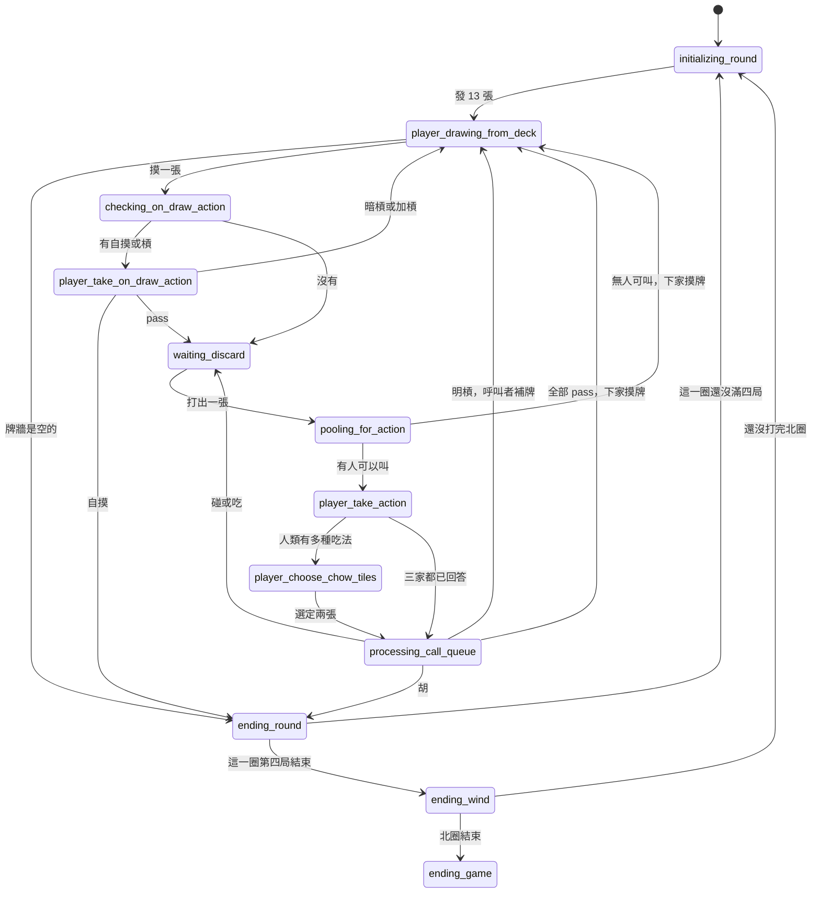

# 02 回合流程

對局是一個明示狀態機。Godot 用一個 `Match` 節點持有狀態，每一步只做這個狀態的工作，然後改 `state`。不要在同一個函式裡把後面的狀態接著跑完。Python 用連續的 `if` 而不是 `elif`，bot 對局時一個 frame 會串過摸牌、打牌與詢問；那是實作巧合，不是規則。Godot 每個狀態結束就讓畫面更新一次。

## 狀態

```text
initializing_round
player_drawing_from_deck
checking_on_draw_action
player_take_on_draw_action
waiting_discard
pooling_for_action
player_take_action
player_choose_chow_tiles
processing_call_queue
ending_round
ending_wind
ending_game
```



## 共用資料

`Match` 上要有：

| 欄位 | 型別 | 用途 |
| --- | --- | --- |
| `wall` | `Array[Tile]` | 牌牆，從尾端摸 |
| `wind` | `int` | 圈風 0–3 |
| `round_index` | `int` | 本圈第幾局，0–3 |
| `players` | `Array[Player]`，長度 4 | index 就是目前座位 |
| `current` | `int` | 目前該摸或該打的座位 |
| `discard_pool` | `Array[Tile]` | 已經沒人要的牌 |
| `discard_buffer` | `Tile` 或空 | 剛打出、還在等叫牌的那張 |
| `min_faan` | `int` | 固定 3 |
| `max_faan` | `int` | 固定 10，計分前先把番數夾到這個值 |
| `call_offers` | 長度 3 的陣列 | 下家、對家、上家各自的可選動作 |
| `call_queue` | 四個陣列 | `win`、`kong`、`pong` 存座位；`chow` 存 `(seat, two_tiles)` |
| `end_round` / `end_match` | `bool` | 給外層迴圈看 |

`Player`：

| 欄位 | 用途 |
| --- | --- |
| `id` | 顯示名稱，例如 `HeuristicBot1`、`HumanPlayer1` |
| `kind` | `human`、`heuristic`、`model` |
| `seat` | 0–3，每局重設 |
| `hand` | 依 `classId` 升序 |
| `melds` | 副露，每組是 3 或 4 張牌的陣列。吃碰槓都 append 到尾端 |
| `score` | 跨局累計 |
| `faan` | 這一手的計番器，裡頭有門風、圈風與四個旗標 |

計番旗標：

| 旗標 | 何時設成 true | 何時清掉 |
| --- | --- | --- |
| `self_drawn_flag` | 每次摸牌（含起手 13 張、含槓後補牌） | 打牌時 |
| `consecutive_kong_count` | 每一次成功的明槓、暗槓、加槓都 +1 | 打牌時歸零 |
| `self_drawn_on_last_tile_flag` | 摸進手的那張是牌牆最後一張 | 打牌時、換局時 |
| `robbing_additional_kong_flag` | 搶槓成功的那一次胡牌 | 換局時，以及任何打牌時 |

起手發 13 張也會把 `self_drawn_flag` 設成 true。莊家接著摸第 14 張時會再設一次。閒家在自己第一次打牌前如果沒摸過牌，這個旗標仍可能是發牌時留下的 true；食出判番時不要用「旗標為 true」當成自摸，自摸只在摸牌後選擇 `self_drawn` 的那條路徑成立。食出路徑不把這個旗標當自摸分。

## 各狀態做什麼

### `initializing_round`

執行 [01-rules.md](01-rules.md) 的換局步驟，然後 `current = 0`，狀態改為 `player_drawing_from_deck`。

發牌順序：座位 0 的 13 張全部摸完，再座位 1，再 2，再 3。每次摸的是當時的牆尾。

### `player_drawing_from_deck`

牆空則 `end_round = true`，狀態改 `ending_round`。

否則牆尾彈出一張，交給 `players[current]`。摸牌函式要：

1. 加進手牌並依 classId 排序。
2. 把計番器的手牌、副露參考更新成現在這兩份。
3. `self_drawn_flag = true`。
4. 若摸完後牆是空的，`self_drawn_on_last_tile_flag = true`。

然後進入 `checking_on_draw_action`。

### `checking_on_draw_action`

呼叫該玩家的 `check_on_draw_action()`。有結果就進入 `player_take_on_draw_action`，否則 `waiting_discard`。

檢查順序與條件見 [01-rules.md](01-rules.md)。自摸的番數用「牌已經在手裡」這份手牌計算，不要再加一次別的牌。

### `player_take_on_draw_action`

人類：畫面在手牌右側放按鈕 `self_drawn`、`additional_kong`、`hidden_kong`、`pass`。點了才繼續。

bot：依 [04-players-ai-logs.md](04-players-ai-logs.md) 的摸牌決策。

結果：

- `self_drawn`：呼叫 `win(null)`。番數換算自摸分。胡牌者加上全額，三家各扣三分之一。寫入 action log 與 winning log。`end_round = true`，進入 `ending_round`。
- `additional_kong`：找到第一組 classId 相符的碰，改成 4 張，手牌移走那一張。`consecutive_kong_count += 1`。若要做搶槓，先進入搶槓詢問；沒人搶才補牌。補牌就是回到 `player_drawing_from_deck`，`current` 仍是這一家。
- `hidden_kong`：把手牌中第一組四張相同移到副露。連槓 +1。回到 `player_drawing_from_deck`。
- `pass`：進入 `waiting_discard`。

log 的手牌與副露是動作發生前的快照。詳見 [04-players-ai-logs.md](04-players-ai-logs.md)。

### `waiting_discard`

人類點自己的一張手牌。bot 呼叫政策，得到手牌 index。

打出的牌從手牌移到 `discard_buffer`。清掉四個計番旗標（連槓歸零）。寫一筆 `action: "discard"`。進入 `pooling_for_action`。

這筆 log 的 `hand` 仍含這張打出的牌，`discard_pool` 還不含它，`action_tile` 是它的 classId。

### `pooling_for_action`

先讓每個 bot 把自己的政策狀態更新成：棄牌池、自己的手牌、自己的副露、以及「下家、對家、上家」三家的副露。

若 `discard_buffer` 是空的，直接 `current = (current + 1) % 4`，回到摸牌。正常打牌不會走到這裡。

否則對 `i = 1, 2, 3`：

```text
seat = (current + i) % 4
offers = players[seat].check_possible_calls(discard_buffer, chow_allowed = (i == 1))
if offers is not empty:
    offers.append("pass")
call_offers[i - 1] = offers
```

`check_possible_calls` 的順序固定是 `win`、`pong`、`kong`、`chow`。判定時把打出的牌暫時加進手牌算胡，算完要把計番器的手牌改回真正的手牌，不能把那張牌留下。

三家都沒有 offers：牌進入 `discard_pool`，清掉 buffer，`current` 換下家，回到摸牌。

有人有 offers：進入 `player_take_action`。

### `player_take_action`

依下家、對家、上家處理 `call_offers`。空的那格跳過。

人類：按鈕顯示該格的動作。若選 `chow` 且 `get_chow_options` 多於一種，進入 `player_choose_chow_tiles`，先不要處理後面兩家。只有一種就直接入隊。

bot：`decide_call_action(tile, offers)` 回一個動作。選 `chow` 時，吃哪兩張用 `get_chow_options(tile)[0]`，也就是選項列表的第一組，而不是 heuristic 內部算出的那組。這是現有 bot 的行為，Godot 的 heuristic bot 保持一致，人類則自己選。

回答後把該格 offers 清掉，並把選擇放入 `call_queue`：

- `win` / `kong` / `pong`：放入座位
- `chow`：放入 `(seat, two_tiles)`
- `pass` 或空：不入隊

三格都空了，進入 `processing_call_queue`。

### `player_choose_chow_tiles`

只給人類。每個選項是兩張手牌的圖，點了就 `(seat, option)` 入隊，回到 `player_take_action` 繼續問剩下的玩家。不要在選完吃法後直接跳去結算，否則對家的胡、碰會被吃掉。Python 這裡會直接進入 `processing_call_queue`，可能少問後面的玩家。Godot 應先問完三家，再靠優先權決定吃不吃得到。

### `processing_call_queue`

依胡、槓、碰、吃取第一個。

胡：

- 勝利用 `win(discard_buffer)`，手牌快照不含這張牌。
- 食出計分：勝者加 `score`，`players[current]`（打出的那家）扣同樣的數。
- winning log 的 `win_from` 是打出者的 id。
- 清掉 buffer。進入 `ending_round`。

明槓：

- 連槓 +1。
- 手牌移走 3 張相同的，與 buffer 組成 4 張副露。若手牌其實有第 4 張，明槓只拿走 3 張，第 4 張留在手裡（現有 `kong()` 會把該 classId 全部拿走再全部放進副露；手牌有 3 張時就是 3+1。手牌若因判定條件剛好是 3 張，不會多拿）。判定已要求正好 3 張，所以副露就是這 4 張。
- `current` 改成槓的那家。清掉 buffer。回到 `player_drawing_from_deck`。

碰：

- 手牌取出該 classId。若多於 2 張，只把多餘的放回手牌，用 2 張加 buffer 組成 3 張副露。
- `current` 改成碰的那家。不摸牌。進入 `waiting_discard`。

吃：

- 依選定的兩張實例從手牌移走，加 buffer，組成 3 張副露。
- `current` 改成吃的那家。不摸牌。進入 `waiting_discard`。

隊列是空的：buffer 進棄牌池，`current` 換下家，回到摸牌。

處理完把 `call_offers` 與 `call_queue` 清掉。

### `ending_round`

`end_round = true`。若 `round_index == 3`，進入 `ending_wind`，否則 `round_index += 1`，回到 `initializing_round`。

### `ending_wind`

`wind = (wind + 1) % 4`，`round_index = 0`。若新的 `wind` 是 0，表示四圈都打完，進入 `ending_game`。否則回到 `initializing_round`。

### `ending_game`

`end_match = true`。把 action log 寫到 `{game_log_location}/game_log_{unix}.json`。若有人胡過，另寫 `winning_log_{unix}.json`。

## 一次打牌的具體順序

東家打出 5 萬。

1. 5 萬放在 buffer，東家手牌少一張，連槓與自摸旗標清掉。
2. 南家可以吃、碰、槓、胡。西家與北家可以碰、槓、胡，不能吃。
3. 南家選吃，西家選碰，北家 pass。
4. 結算時碰優先於吃。西家碰，5 萬不進棄牌池。
5. 輪到西家打牌。南家的吃取消。

若西家改選胡，而北家也選胡，西家是下家方向的第一個，由西家胡，東家付整份分數。
